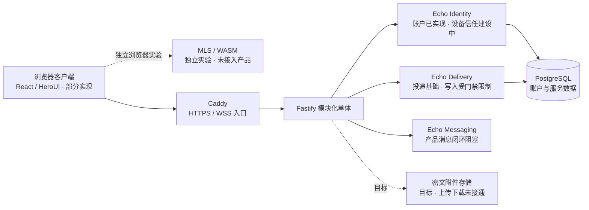
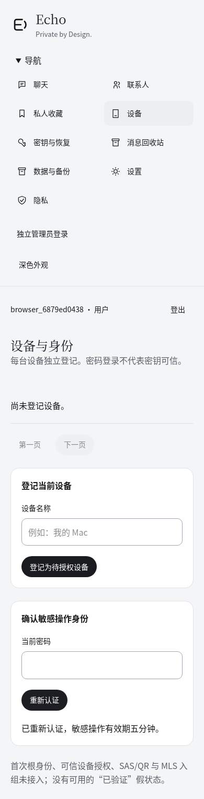
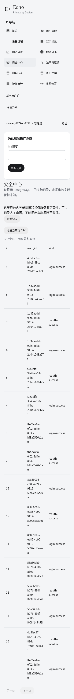

<div align="center">
  
  <h1>Echo Native</h1>
  <p><strong>Private by Design.</strong></p>
  <p>面向自主通信的模块化单体：让身份、投递和端到端加密各有清晰的边界。</p>
  <p>React 19 · HeroUI v3 · Fastify · PostgreSQL · MLS / WASM 实验</p>
</div>

> ⚠️ **当前状态：PARTIAL，不具备生产上线条件。** 账户与数据库工作流已在 Cloud 临时环境验证；产品级 MLS、可信设备与加密通信仍未完成。聊天写入保持 `503 MLS_NOT_READY`，独立密码学实验不能证明产品已实现端到端加密。

[项目简介](#项目简介) · [核心能力](#-核心能力) · [技术架构](#-技术架构) · [安全设计](#-安全设计) · [开发与验证](#-开发与验证) · [文档](#-项目文档) · [限制与路线图](#-当前限制与路线图)

## 项目简介

Echo Native 是一个自主通信项目，目标是让用户通过自己的服务管理账户和密文投递，同时将私密内容的密码学处理留在客户端。它采用独立的 Identity、Delivery 与 Messaging 边界，使用模块化单体控制运维复杂度。

项目选择独立的原生通信架构，不依赖 Matrix/Synapse 运行时；这是架构取舍，并不意味着已完成与 Matrix 等同的功能。群组加密计划采用 RFC 9420 MLS，借助成熟库处理成员、密钥和 epoch，而非自行设计群组密码协议。

◆ **职责边界：** 客户端目标是管理设备密钥、验证身份并处理 MLS；服务器负责账户、权限、密文存储与投递排序。当前服务端能力和独立 MLS 实验已有验证，但两者尚未形成可用的加密通信闭环。

## 💬 核心能力

状态含义：✅ 已实现并验证特定范围 · 🟡 部分实现 · ⛔ 尚未实现或阻塞。

| 能力         | 状态 | 当前范围                                                                          |
| ------------ | ---- | --------------------------------------------------------------------------------- |
| 账户与身份   | 🟡   | 注册、邀请、Argon2id 登录、会话与改名已验证；密码学根身份绑定未完成               |
| 设备管理     | 🟡   | pending 设备目录与服务访问撤销；可信授权、SAS/QR 未完成                           |
| E2EE         | ⛔   | 真实 MLS 库仅在独立 WASM 实验中运行；产品发送门禁关闭                             |
| 一对一通信   | ⛔   | 尚无可用的端到端消息闭环                                                          |
| 群组通信     | 🟡   | 实验验证 Welcome、Commit、Remove 与 epoch；未接入产品群组                         |
| 离线同步     | ⛔   | 缺完整 provider 持久化、outbox 与重连协议                                         |
| 附件加密     | 🟡   | 本地 AES-256-GCM 加解密已验证；上传和 MLS 密钥分发未接通                          |
| 消息生命周期 | 🟡   | 删除请求、隐藏和到期调度有服务端基础；墓碑传播与物理清理未完成                    |
| 密钥恢复     | ⛔   | 缺恢复凭据、设备授权和状态新鲜性验证                                              |
| 管理后台     | 🟡   | 账户、设备、注册、审计和当前页 CSV 有真实数据；部分统计与备份功能缺数据源或执行器 |
| 数据备份     | 🟡   | ✅ 服务元数据加密归档及只读预览已验证；聊天历史与系统隔离恢复阻塞                 |

## 🧩 技术架构



虚线表示独立实验或尚未接通的目标能力；服务端不会因消息的外层类型推断 MLS 状态。

## ⚙️ 技术栈

| 技术                  | 声明或验证版本                             | 职责                                            |
| --------------------- | ------------------------------------------ | ----------------------------------------------- |
| React / React DOM     | 19.3.1                                     | 浏览器界面                                      |
| HeroUI / Tailwind CSS | 3.2.7 / 4.3.5                              | 组件与样式                                      |
| TypeScript / Vite     | 5.9.3 / 8.3.6                              | 类型检查与前端构建                              |
| Node.js               | `>=24.17.0 <25`；Cloud 验证 24.22.1        | 应用运行时                                      |
| Fastify / pg          | 5.12.8 / 8.23.1                            | HTTP、WebSocket 与数据库访问                    |
| PostgreSQL            | Cloud 验证 17.11                           | 业务数据和事务；基线 manifest 当前验证 major 17 |
| OpenMLS / RustCrypto  | 0.9.2 / 0.6.0                              | 独立 RFC 9420 WASM 实验，尚未接入产品           |
| Rust / wasm-bindgen   | 工具链 1.99.1 / 0.2.105                    | 实验构建与浏览器绑定                            |
| Caddy / systemd       | Cloud 实验 Caddy 2.6.2；systemd 未锁定版本 | HTTPS 入口与目标服务管理                        |

npm 依赖见 [package.json](package.json) 和 [package-lock.json](package-lock.json)；实验依赖见 [Cargo.toml](crypto/mls-lab/Cargo.toml) 和 [Cargo.lock](crypto/mls-lab/Cargo.lock)。

## 🔐 安全设计

- **MLS 与密钥：** 实验固定 `MLS_128_DHKEMX25519_AES128GCM_SHA256_Ed25519`，真实验证了两个独立 Chromium 上下文中的加解密和成员移除。客户端私有 group state 的安全持久化与账户绑定仍是准入条件。
- **设备身份：** 密码登录和设备目录登记不等于设备可信。根身份授权、指纹核验和 SAS/QR 尚未完成；服务端撤销会话也不等于 MLS 成员撤权。
- **密文与附件：** 服务器目标是保存不透明密文，不持有浏览器私钥、epoch secret 或完整私有 group state。本地附件 AEAD 已验证，但密钥经 MLS 分发、授权上传和下载仍未实现。
- **删除与恢复：** 服务端已有删除意图与隐藏基础；离线加密墓碑、独立删除证据、物理清理及旧备份防回滚仍阻塞。元数据归档的只读预览不能恢复聊天或证明删除状态新鲜。

服务器可见账户、设备和会话目录、IP/登录与审计记录、成员关系、投递时间/顺序/长度、删除目标及附件引用等元数据。服务器仍可能拒绝服务或删除数据；不能承诺追回截图、外部备份或已解密副本。

> 🛡️ **已知安全阻塞：** Cargo audit 报告的 `crypto-bigint` 时序公告进入当前 WASM 依赖树；可选锁闭中还有其他公告。未忽略公告，也未解除产品门禁。详情见[密码学审查](docs/native-cryptography.md)和[工程验证](docs/static-verification-report.md)。

## 📁 项目结构

```text
echov2/
├── src/client/          浏览器界面、本地加密前置模块
├── src/server/          账户、设备、投递、生命周期与管理 API
├── src/shared/          客户端与服务端共享契约
├── crypto/mls-lab/      独立 OpenMLS / WASM 实验
├── migrations/          历史迁移、版本化基线与执行说明
├── scripts/             迁移、工程和 Cloud 验证工具
├── deploy/              Caddy、systemd 与 PostgreSQL 配置样例
├── docs/                架构、安全、验证报告及 SBOM
└── public/echo.svg      Echo 品牌标志
```

## 🎨 界面与设计

界面使用 React 19、HeroUI v3 和 **Taste / Achromatic Ledger** 视觉方向：Claude 式衬线标题、无衬线正文、系统字体和深浅主题。布局面向桌面与手机，使用微动效并尊重 `prefers-reduced-motion`，提供键盘与无障碍基础。

Cloud 中已验证 Chromium 390px 页面无横向溢出、reduced-motion 偏好和键盘退出；这不是完整的跨浏览器视觉或无障碍审计。以下截图由 Cloud Chromium 实际运行生成，桌面视口为 1440×1000（管理端 1280×900）、手机为 390×844；长页面保留完整滚动内容。使用临时 PostgreSQL 与合成账户，未填充模拟聊天或固定统计。

### 🌐 真实界面

| 用户端                                                                                     | 管理端                                                                              |
| ------------------------------------------------------------------------------------------ | ----------------------------------------------------------------------------------- |
| **登录 / 注册入口 · 桌面**<br/>     | **Dashboard · 桌面**<br/>  |
| **聊天主界面 · 桌面**<br/> | **用户管理 · 桌面**<br/>   |
| **设备与身份 · 手机**<br/>          | **安全中心 · 手机**<br/> |

<details>
<summary>设备管理 · 桌面</summary>


</details>

聊天页显示可信设备和 MLS 准入阻塞；设备目录中的 pending 不代表可信。Dashboard 数值来自本轮临时数据库，未知地区、流量和可信在线设备保持未知。手机记录表支持键盘及触摸横向滚动。

## 🔍 开发与验证

项目使用 **Codex Cloud** 进行远程开发与验证；本机无需安装项目依赖。仅在获授权的隔离 Cloud 环境执行以下工程检查，依赖由锁文件固定：

```sh
npm ci
npm run typecheck
npm run lint
npm run format:check
npm run check:ast
npm run check:source
npm run build:client
npm run build:server
```

本轮七项工程检查均重新执行，实际退出码见[工程验证](docs/static-verification-report.md)。Rust native/WASM 构建、OpenMLS 浏览器实验及两标签 IndexedDB 测试的前提与命令见 [MLS 实验说明](crypto/mls-lab/README.md)。两个独立浏览器上下文不是两台物理设备；Firefox/WebKit 下载曾受 Cloud 网络策略阻止，iOS 实机未验证。

数据库迁移使用独立修正版基线 → 002 → 003 → 004 → 005 → 006。新库与 **synthetic legacy fixture** 已在临时 PostgreSQL 验证并得到一致业务 Schema；这不证明未知持久化环境的迁移历史。应用启动不会自动迁移，操作前请阅读[迁移说明](migrations/README.md)。

## 🚀 部署与资源

目标环境为 **Debian · 2 GB RAM · 1 核 CPU · 20 GB SSD**，采用 Fastify 单进程、PostgreSQL 单实例、Caddy 和 systemd；目标附件存储为本地密文文件。配置样例不代表生产部署已完成。

Cloud 短时真实全栈请求已运行，但 Docker 的 2 GB / 1 核限制实际未生效，磁盘配额和持续压力测试也未完成。因此低配容量、灾备及生产部署均未验收。详见[部署与运维](docs/native-deployment-operations.md)。

## 📚 项目文档

| 分类           | 权威资料                                                                                                                                                                                    |
| -------------- | ------------------------------------------------------------------------------------------------------------------------------------------------------------------------------------------- |
| 项目状态与证据 | [第三阶段报告](docs/phase-three-report.md) · [工程验证](docs/static-verification-report.md) · [本轮验证数据](docs/evidence/final-review.json) · [基线验证](docs/evidence/verification.json) |
| 架构与协议     | [原生架构](docs/native-architecture.md) · [投递协议](docs/native-protocol-delivery.md)                                                                                                      |
| 密码学与身份   | [密码学](docs/native-cryptography.md) · [身份、设备与恢复](docs/native-identity-devices-recovery.md) · [MLS 实验](crypto/mls-lab/README.md)                                                 |
| 数据与迁移     | [迁移操作](migrations/README.md) · [Cloud 数据库验证](docs/cloud-bootstrap-verification.md) · [数据生命周期](docs/native-data-lifecycle.md)                                                 |
| 安全与运维     | [威胁模型](docs/native-security-threat-model.md) · [部署与运维](docs/native-deployment-operations.md) · [实施准入](docs/native-implementation-plan.md) · [决策记录](docs/decisions.md)      |
| 依赖清单       | [npm SBOM](docs/evidence/npm-sbom.json) · [Rust SBOM](docs/evidence/rust-sbom.json)                                                                                                         |

## 🧭 当前限制与路线图

- ✅ **已验证：** 临时库双路径迁移与权限、注册/邀请/登录/会话、七项工程检查，以及限定范围的 Chromium、附件 AEAD 和 MLS 库实验。
- 🟡 **部分完成：** 设备目录、投递基础、删除意图、管理后台、本地附件加密与服务元数据归档。
- ⛔ **BLOCKED：** 可信设备与 MLS 产品集成、私聊和群聊、离线墓碑、密钥恢复、系统备份隔离恢复及依赖安全准入。
- 🌐 **待运行验证：** Firefox、WebKit、iOS 实机、真实掉电/磁盘满、完整无障碍审计、受限资源下的持续负载和恢复演练。
- 🚀 **生产部署限制：** 在安全门禁、删除与恢复保障、依赖公告和容量验证解决前，不具备生产上线条件。

## 🤝 许可证与贡献

仓库目前没有确认的项目级 LICENSE；请勿将第三方依赖的许可证视为 Echo Native 的项目许可证。第三方依赖清单见上方 SBOM；分发前需要核对各依赖义务。

欢迎通过 Issue 或 Pull Request 提供可复现的问题与变更说明。涉及迁移、密码学、设备信任或数据删除的贡献，应说明兼容路径、验证范围与未覆盖的风险。
