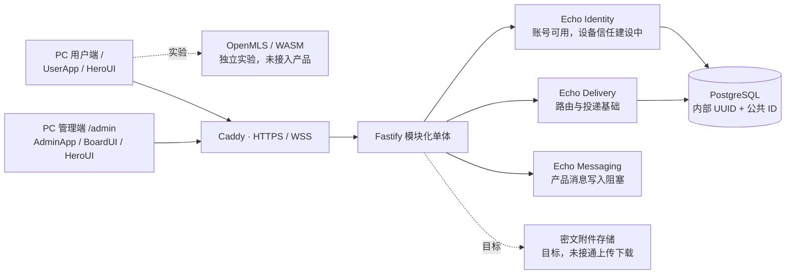
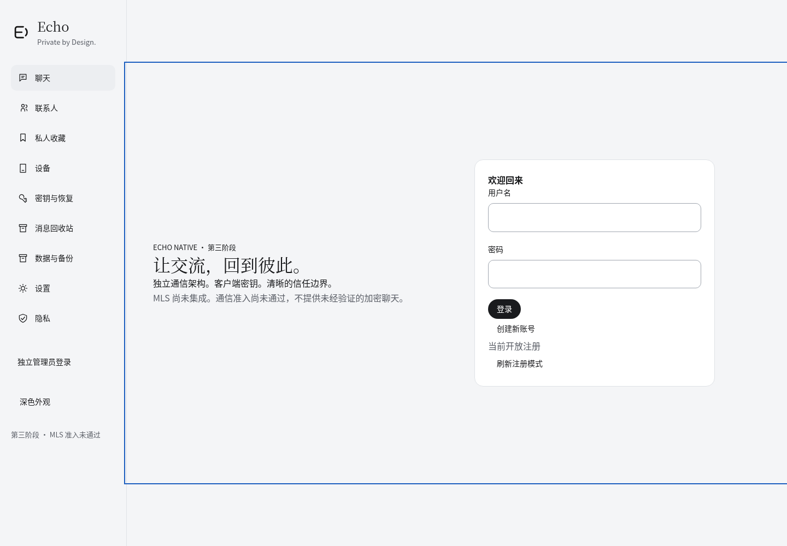
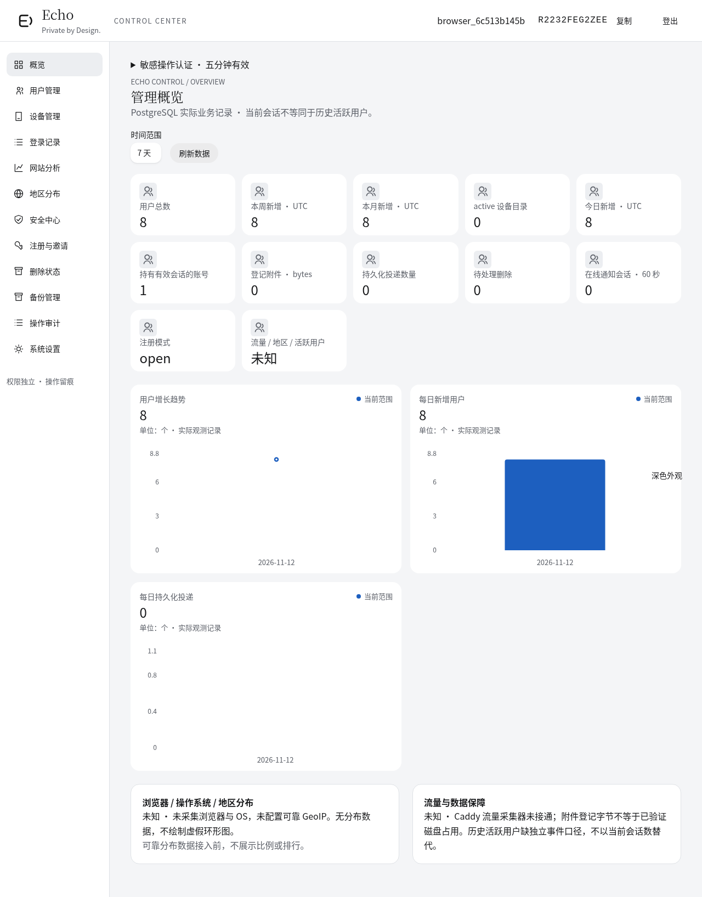
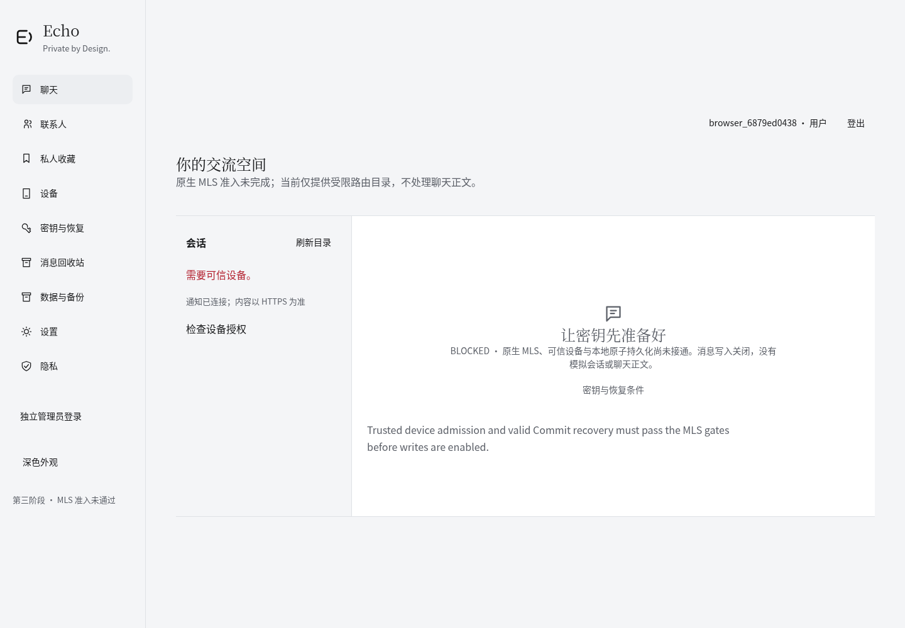
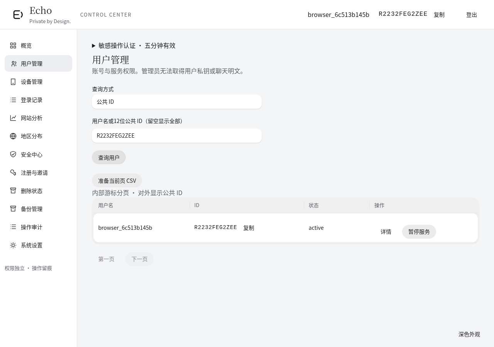
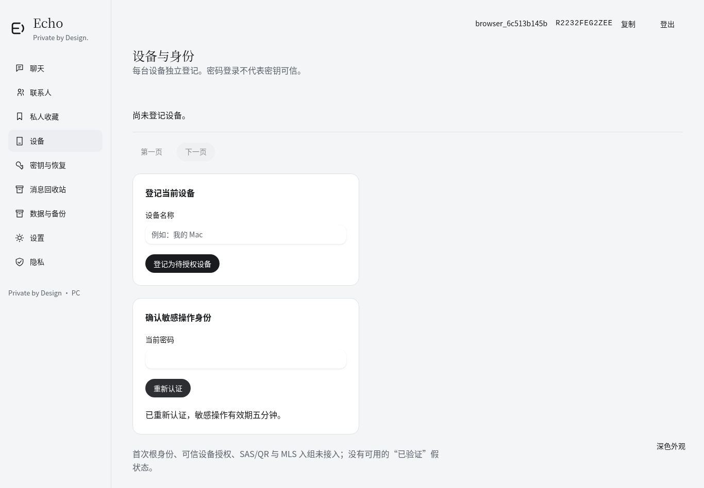
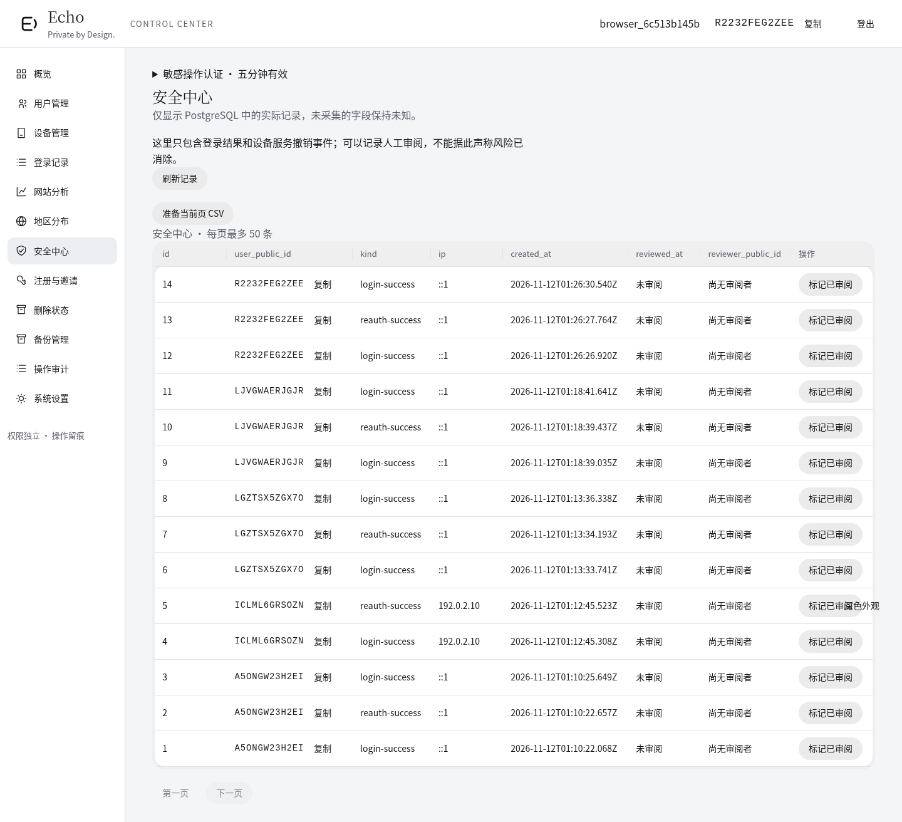
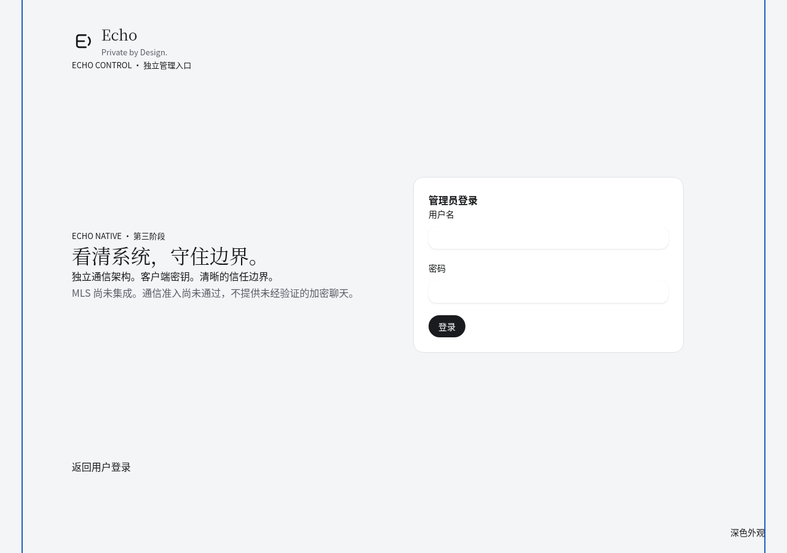
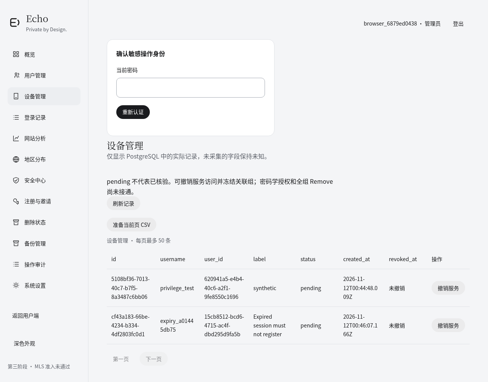

<div align="center">
  
  <h1>Echo Native</h1>
  <p><strong>Private by Design.</strong></p>
  <p>自主身份 · 密文投递 · 清晰的客户端信任边界</p>
  <p>React 19 / HeroUI v3 / BoardUI · Fastify · PostgreSQL · OpenMLS / WASM 实验</p>
</div>

> 🛡️ **当前整体 PARTIAL，尚不具备生产部署条件。** 账户、迁移、管理元数据和桌面界面已在 Cloud 隔离环境验证；产品级 MLS、可信设备、离线删除和恢复仍阻塞。聊天写入继续拒绝 `503 MLS_NOT_READY`。

[项目](#项目简介) · [能力](#-核心能力) · [架构](#-系统架构) · [安全](#-安全与元数据) · [界面](#-pc-用户端与管理端) · [截图](#-真实界面截图) · [开发](#-开发与验证) · [文档](#-权威文档) · [限制](#-当前限制与路线图)

## 项目简介

Echo Native 探索一种可自主部署的通信架构：服务端管理账户、路由和密文投递，客户端负责私钥、设备信任和消息密码学。采用模块化单体，控制部署与运维复杂度。

项目不依赖 Matrix/Synapse，选择独立 Identity、Delivery、Messaging 边界；这是架构取舍，不代表已具备 Matrix 的成熟功能。群组密码学采用 RFC 9420 MLS 和成熟 OpenMLS 实现，避免自创群组加密协议。独立库实验已经运行，产品通信集成尚未完成。

## 💬 核心能力

✅ 表示指定范围已实现并验证；🟡 表示部分实现；⛔ 表示阻塞或尚未实现。

| 范围            | 状态 | 当前真实能力                                                                                  |
| --------------- | ---- | --------------------------------------------------------------------------------------------- |
| 账户            | ✅   | 注册、邀请码、Argon2id 登录、改名、重新认证、退出和受众隔离                                   |
| 公共用户 ID     | ✅   | 随机12位 Base32、数据库唯一约束、碰撞重试、旧账号回填、显示/复制/查询；内部 UUID 保留         |
| 设备            | 🟡   | pending 登记、目录和服务访问撤销；根授权、Credential、SAS/QR 未完成                           |
| 端到端通信      | ⛔   | 私聊、群聊和离线消息没有产品级安全闭环；不提供明文替代                                        |
| MLS / WASM      | 🟡   | 独立实验验证 Welcome、Commit、Application、Remove 与 epoch；未接入账号和投递                  |
| 本地存储 / 附件 | 🟡   | IndexedDB 原子操作前置、附件 AEAD 已验证；完整 Group State、Outbox 和 MLS 分发未完成          |
| 删除与恢复      | 🟡   | 删除意图、隐藏、到期调度和幂等基础；独立锚、物理 purge、离线墓碑及可信恢复阻塞                |
| 用户归档        | ✅   | 服务元数据加密下载与只读预览；保留旧格式 UUID 绑定，不包含聊天、私钥或恢复能力                |
| 管理后台        | 🟡   | 实际账户、设备、登录、安全事件、审计、邀请、CSV 和业务趋势；流量/GeoIP/灾备仍缺数据源或执行器 |

## 🧩 系统架构



◆ 两个入口有独立布局、导航和工作区；共享基础组件不共享管理员权限。虚线表示实验或目标能力。

## ⚙️ 技术栈

| 技术                       | 实际声明 / 验证版本                    | 职责                                            |
| -------------------------- | -------------------------------------- | ----------------------------------------------- |
| React / React DOM          | 19.3.1                                 | 桌面浏览器界面                                  |
| HeroUI / Tailwind CSS      | 3.2.7 / 4.3.5                          | 基础交互、表单、表格与样式                      |
| BoardUI                    | 官方 MCP CLI 0.5.9 获取的免费源码      | KPI、面积/折线组合与柱状图卡片                  |
| Recharts / Remixicon React | 3.9.2 / 4.9.0                          | BoardUI 内部图表与图标；用户已明确允许          |
| TypeScript / Vite          | 5.9.3 / 8.3.6                          | 类型检查与客户端构建                            |
| Fastify / pg               | 5.12.8 / 8.23.1                        | HTTP、WebSocket 与 PostgreSQL                   |
| Node.js / PostgreSQL       | Cloud 24.22.1 / 17.11                  | 应用与临时数据库验证；Node 声明 `>=24.17.0 <25` |
| OpenMLS / RustCrypto       | 0.9.2 / 0.6.0                          | 独立 MLS 实验                                   |
| Rust / wasm-bindgen        | 1.99.1 / 0.2.105                       | native/WASM 构建                                |
| Caddy / systemd            | Cloud 实验 Caddy 2.6.2；systemd 未锁版 | 目标 HTTPS 入口与进程管理                       |

依赖以 [package.json](package.json)、[npm 锁文件](package-lock.json)、[Cargo.toml](crypto/mls-lab/Cargo.toml) 和 [Cargo.lock](crypto/mls-lab/Cargo.lock) 为准。BoardUI 以源码分发，不虚构运行时包版本；版权、修改范围和 MIT 文本见[来源说明](src/client/components/boardui/notice.md)。未复制未授权 Pro 源码。

## 🔐 安全与元数据

- **标准密码学：** MLS 实验使用真实 OpenMLS，固定套件 `MLS_128_DHKEMX25519_AES128GCM_SHA256_Ed25519`。实验通过不证明 Echo 已完成端到端通信。
- **客户端密钥：** 私钥、epoch secret 和完整私有 Group State 的目标边界在客户端；可信身份、完整持久化和原子 Outbox 仍是准入条件。
- **设备与撤权：** 密码登录、pending 目录和 HTTP 会话撤销均不证明密码学信任或群成员撤权；产品 Add/Remove、Welcome/epoch 一致性仍待接通。
- **附件与删除：** 本地 AES-GCM 是附件前置能力；MLS 密钥分发、墓碑传播、独立删除证据和物理清理未完成。不能保证追回截图或已解密副本。
- **备份防回滚：** 元数据预览不恢复密钥或状态。系统灾备、离线删除新鲜性及旧备份防复活仍阻塞。
- **公共 ID：** 60位随机展示标识，不是认证凭据；不替代 UUID、权限或密码学身份。

服务器可见账户和设备目录、会话、IP/登录事件、审计、成员/路由关系、投递时间/长度/顺序、删除目标及附件引用。管理员无法通过现有 API 获取聊天明文、附件明文或用户私钥；服务器仍可拒绝服务，元数据真实性和可用性也有局限。

> ⛔ **供应链安全准入未通过：** `crypto-bigint` 时序公告进入当前 WASM 依赖树；Cargo 锁闭另有公告。未忽略公告、未强制套用不兼容补丁，crypto-gate 持续关闭。详情见[密码学](docs/native-cryptography.md)。

本轮本地源码修复了通知挂载与会话撤销的竞争、通知过期/背压处理及管理员账号状态的版本校验。新增008待审迁移，在设备撤销同事务失效公开Credential、清除未领取KeyPackage；不代表MLS密码学撤权。静态复核已进行，相关运行和迁移NOT_RUN；完整台账见[第三阶段报告](docs/phase-three-report.md)。

## 👤 PC 用户端与管理端

仅支持 PC 和笔记本桌面浏览器，布局下限为 **1024 CSS px**；保留窗口缩放、深浅主题和 `prefers-reduced-motion`。已移除移动导航、折叠菜单及手机/平板专用断点。

| 入口     | 登录与布局                                   | 操作范围                                            |
| -------- | -------------------------------------------- | --------------------------------------------------- |
| `/`      | 默认用户登录，支持注册；认证后独立用户工作台 | 聊天门禁、设备目录、设置、隐私、归档和当前能力说明  |
| `/admin` | 独立管理员登录与控制台；未认证路由跳转登录   | 真实元数据、账户/设备管理、注册邀请、安全事件与审计 |

用户登录页提供明显的「管理员登录」按钮；用户工作台不显示后台导航。admin audience、Cookie、Session、API 权限与审计独立，没有公开管理员注册。

界面沿用 Echo Logo、**Achromatic Ledger**、系统原生字体、Claude 式衬线标题与无衬线正文。BoardUI 免费卡片接入真实 PostgreSQL 数据，HeroUI v3 提供基础操作；删除原有手写 SVG 图表。统计支持7/30/90日筛选，区分真实零值、未知、空范围、加载和失败。没有可靠流量、GeoIP、浏览器或 OS 数据时不绘制分布图；独立环形图/横向排行等 Pro 卡片暂无授权。

## 🌐 真实界面截图

Cloud Chromium 实际运行，临时 PostgreSQL 与合成账户；桌面视口1440×1000、1366×900或1280×900，长页面保留完整滚动内容。没有生成产品图、模拟聊天或固定统计。

| 用户端                                                                                     | 管理端                                                                                          |
| ------------------------------------------------------------------------------------------ | ----------------------------------------------------------------------------------------------- |
| **登录 / 注册**<br/>                    | **Dashboard · 真实 BoardUI 图表**<br/> |
| **聊天 · 当前安全门禁**<br/> | **用户管理 · 短 ID 与真实查询**<br/>       |
| **设备与身份**<br/>                    | **安全中心**<br/>                       |

<details>
<summary>独立管理员登录与设备管理</summary>




</details>

## 📁 项目目录

```text
echov2/
├── src/client/app/         PC 双入口、独立工作区与共享 Hooks
├── src/client/features/    账户、设备、数据与管理页面
├── src/client/components/  HeroUI 组合及 BoardUI 免费源码
├── src/server/             认证、身份、投递、生命周期与管理 API
├── src/shared/             类型契约与输入校验
├── crypto/mls-lab/         独立 OpenMLS / WASM 实验
├── migrations/             历史 SQL、独立基线和增量迁移
├── scripts/                Cloud 迁移、并发、浏览器与工程验证
├── deploy/                 Caddy、PostgreSQL 和 systemd 样例
├── docs/                   权威技术文档、报告、截图及 SBOM
└── public/echo.svg         Echo 品牌标志
```

## 🔍 开发与验证

当前主开发环境为本地 `echov2`，基线已包含合并的 [PR #2](https://github.com/koajsj/echov2/pull/2)。旧 `echo-v2` 仅作只读参考。本机禁止安装/下载新的项目依赖或 Rust/WASM 工具链，不恢复旧 node_modules；本轮不运行测试、构建、应用、数据库迁移或生产部署。历史 Cloud 成功记录不作为当前修改的运行验证。

已有独立 TypeScript / Prettier 工具可按[工程报告](docs/static-verification-report.md)显式指定路径进行静态检查；缺项目依赖时完整类型/Lint标记NOT_AVAILABLE，不修改规则或补假类型。不得在当前本机执行依赖安装命令。供应链可执行只读取锁文件的 `npm audit --package-lock-only --ignore-scripts`，不安装包。

Rust/WASM 和库实验命令见 [MLS 实验](crypto/mls-lab/README.md)。真实数据库、认证、短 ID、删除竞争及浏览器脚本需要明确隔离环境参数，不对任意数据库直接运行。命令与实际退出码见[工程验证](docs/static-verification-report.md)。

新库规划使用修正版独立基线001 → 002 → 003 → 004 → 005 → 006 → 007公共ID → **008设备公开材料撤销**。008尚未执行或运行验证；已有已核验前缀只追加缺失版本；未知持久化环境不得自动迁移。应用启动不执行迁移。操作前阅读[迁移说明](migrations/README.md)。

## 🚀 部署与资源

目标为 **Debian / 2 GB RAM / 1 核 CPU / 20 GB SSD**，保持 Fastify + PostgreSQL + Caddy + systemd，不引入 Redis、Kafka、Kubernetes 或微服务。

Cloud 实际 cgroup 仍为32 GB / 4核，swap 无限制；Docker 请求2 GB / 1核未实际生效。短时功能负载与 Node 进程观测单独记录，**不是低配容量验收**。20 GB磁盘配额、真实受限持续负载、系统隔离恢复尚未通过。配置样例不代表已完成生产部署。

## 📚 权威文档

| 分类           | 文档                                                                                                                                                                         |
| -------------- | ---------------------------------------------------------------------------------------------------------------------------------------------------------------------------- |
| 当前状态与证据 | [第三阶段报告](docs/phase-three-report.md) · [工程验证](docs/static-verification-report.md) · [PC改造证据](docs/evidence/pc-review.json)                                     |
| 架构与投递     | [原生架构](docs/native-architecture.md) · [投递协议](docs/native-protocol-delivery.md)                                                                                       |
| 密码学与身份   | [密码学](docs/native-cryptography.md) · [身份、设备与恢复](docs/native-identity-devices-recovery.md) · [MLS实验](crypto/mls-lab/README.md)                                   |
| 数据与迁移     | [迁移](migrations/README.md) · [Cloud数据库](docs/cloud-bootstrap-verification.md) · [生命周期](docs/native-data-lifecycle.md)                                               |
| 安全与运维     | [威胁模型](docs/native-security-threat-model.md) · [部署](docs/native-deployment-operations.md) · [准入计划](docs/native-implementation-plan.md) · [决策](docs/decisions.md) |
| 供应链         | [npm SBOM](docs/evidence/npm-sbom.json) · [Rust SBOM](docs/evidence/rust-sbom.json) · [BoardUI许可](src/client/components/boardui/notice.md)                                 |

## 🧭 当前限制与路线图

- ✅ **已验证范围：** 账户、公共ID迁移、权限和幂等；PC双入口；真实元数据图表、查询、复制及下载；工程检查与独立MLS实验。
- 🟡 **部分完成：** 设备目录、消息投递基础、删除意图、本地附件、元数据归档、管理后台与有限静态扫描。
- ⛔ **BLOCKED：** 活动密码学依赖公告、可信设备、产品MLS、私聊/群聊、离线同步与墓碑、密钥恢复、灾备和低配资源验收。
- 🔍 **NEEDS_RUNTIME_VERIFICATION：** 安全内核接通后的产品级多设备、Commit冲突、真实崩溃/磁盘满、删除新鲜性、隔离恢复与完整可访问性验证。
- ◆ **交付边界：** 第三阶段继续收敛，不增加第四阶段，不自动合并或生产部署。

## 🤝 许可证与贡献

项目根目录没有确认的整体 LICENSE，不擅自声明开源授权。BoardUI 免费源码单独保留上游 MIT 许可，其他依赖义务见 SBOM；这不授予本项目整体许可证。

欢迎提交可复现 Issue 或 PR。涉及迁移、密码学、设备信任、删除或恢复的变更，应附兼容路径、实际验证和未覆盖风险。重要功能变更须同步更新本页与对应权威文档。
