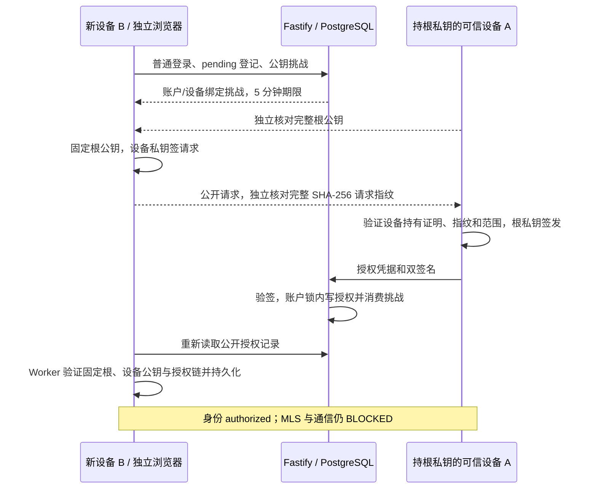

# 账户根身份与产品集成续进报告

2026-11-15 · 基线 `ec47b6acc5e728c5b0f4af4dd1dc001388ddd55b` · Codex Cloud · main。🛡️ **整体 PARTIAL，产品加密通信 BLOCKED，crypto-gate 保持关闭。** 本轮实际新增身份代码、数据库迁移、API、Worker 与用户界面，没有把 MLS 实验迁入产品。

## 实际实现

客户端 `IdentityClient → identity-worker → identity-engine` 使用浏览器 WebCrypto Ed25519。根签名密钥与设备签名密钥分别生成，私钥为不可导出的 CryptoKey，持久化于 `echo-client-identities-v1` IndexedDB；服务端只收到公钥、公开声明和签名。Web Locks 按账户覆盖读取、生成/验签、签名与本地提交。Worker 处理身份操作，**尚不处理 MLS 或消息加解密**；Worker 和不可导出属性不防御同源 XSS、恶意扩展、浏览器配置泄露或能读取本机存储的攻击者，不等同硬件保护或经过口令加密的私钥保险库。

首次根身份是版本 1 的自签名声明，绑定 HTTPS origin、账户 UUID、12 位 Base32 公共 ID、初始设备和挑战 ID。首次信任来自本机生成的根公钥；服务器目录不能独立证明它可信。首次账户归属仍依赖账号认证及用户选择的可信客户端，没有密钥透明度、全局防等价替换保证或防旧备份回滚锚。根首次登记不可替换；根轮换、恢复 Credential、密钥恢复和续期 **NOT_AVAILABLE**，不接受版本 2 或通过密码重置根身份。

设备 Credential 的规范化消息为带 `echo/device-credential/v1` 域标识的固定顺序 JSON 数组，覆盖根版本/公钥、完整挑战、账户/设备 ID、公钥、nonce、签发时间、挑战期限与凭据期限。新设备先用自己的 Ed25519 私钥签名证明持有，根设备验签后签发根授权，新设备再验证固定根公钥及两份签名。共享契约拒绝未知字段和非规范时间/编码；算法由 v1 协议固定为 Ed25519，没有自实现签名、摘要或群组密码算法。

### 授权与会话

界面采用**完整根公钥和完整请求指纹的人工双向核对**。用户必须通过独立可信渠道核对，传输请求不代表可信；没有实现 QR 摄像头流程或经过评审的 SAS 协议，二者仍 BLOCKED / NOT_RUN。只有本机验签确认且持根私钥的设备才显示签发操作；普通授权设备没有根私钥，不能转授。根私钥不会复制到第二台设备。

密码登录始终创建未绑定会话。重新登录同一浏览器后，恢复旧设备绑定需要新的、绑定当前 session ID 的五分钟一次性挑战及设备签名；签名采用独立 `echo/device-session-binding/v1` 域，不能用授权签名或另一个会话的证明替代。原挑战 ID 重试返回原挑战；同 ID 换公钥、换设备、换账号/会话均拒绝。授权提交的未知结果用原签名请求重试或读取公开记录核实，不重新生成密钥。

Credential 撤销目前是服务端公开授权撤回，没有根签名撤销声明或独立新鲜性证明；离线客户端不能仅凭旧授权链证明未被撤销。完整密码学撤权仍 BLOCKED。

状态分开记录：原 `devices.status` 仍为 `pending/active/revoked`；新身份记录派生 `authorized/revoked/expired`，凭据有效期 30 天。新签名授权**不设置 active**，不写旧目录根/凭证表，不产生或领取 KeyPackage，不获得通信资格。尚无续期/根轮换流程，期限结束后拒绝签发/恢复绑定，不能通过新挑战覆盖旧凭据。

### 数据库和 API

新增 `009-product-identity.sql`：`identity_roots`、`identity_device_keys`、`identity_challenges`、`identity_authorizations`、`identity_session_challenges`，共五张公开材料表；账户/设备外键、根和设备唯一性、挑战唯一消费、签名/公钥长度约束及两类安全事件。授权与挑战消费、会话绑定与挑战消费分别使用同一 PostgreSQL 事务；账户锁使同账户签发、撤销和重试串行化。009 的 owner 固定 search_path 触发器随原设备撤销同步撤销新授权；只撤服务身份，不声称产生 MLS Remove。

运行 API 仅有新表 SELECT/INSERT 与挑战 consumed_at 的列级 UPDATE，无根、设备公钥、凭据签名的 UPDATE/DELETE 权限，无新 KeyPackage/旧凭证签发权。签名检查在应用层完成，数据库约束不提供 Ed25519 验签；数据库管理员能破坏或替换公开目录，客户端必须固定/核对根，不能声称抵抗首次信任时的恶意服务端。

| 接口                                          | 真实行为                                                 |
| --------------------------------------------- | -------------------------------------------------------- |
| `GET /v1/crypto-identity`                     | 本账户公开根和授权，明确 communication=BLOCKED           |
| `POST /v1/crypto-identity/challenges`         | 已登记本机的公钥绑定与五分钟挑战，最多五个未过期待用挑战 |
| `POST /v1/crypto-identity/initialize`         | 根自签名、根授权、设备持有证明全部验证后原子登记         |
| `POST /v1/crypto-identity/authorize`          | 已授权会话与有效根签名签发，精确重试对账                 |
| `POST /v1/crypto-identity/session-challenges` | 为当前登录会话和已授权旧设备创建绑定挑战                 |
| `POST /v1/crypto-identity/bind-session`       | 验证旧设备对当前会话挑战的签名并原子绑定                 |

所有写接口要求 user audience、同源、CSRF、当前 session ID 和近期认证；管理员登录入口不授予签发权限。管理员可撤销服务访问，不能通过管理 API 获取私钥或生成根签名。元数据包括账户/设备关联、公钥、挑战、凭据期限、签名和安全事件；不含聊天正文、Root/Device 私钥或 Epoch Secret。

001–008、历史 baseline 及其摘要均保持原字节。新增 `migrations/product-identity-v1/manifest.json` 原样继承前八项并追加 009；默认迁移计划使用新 manifest，历史 manifest 仍可显式加载。迁移不在服务启动时执行；仅已在 Cloud 临时 PostgreSQL 17.11 验证，不是生产迁移/部署。

## MLS / Provider 的实质阻塞

真实产品尚无 OpenMLS Adapter、完整 Provider、MLS Worker、WASM 绑定或消息链路。未来映射必须把真实授权链和账户固定根纳入 Credential 验证，并核对 MLS Leaf 的 signature_key；在评审与联调前不发送任何可用 KeyPackage。现有身份签名键是不可导出 WebCrypto 键，**不能直接交给 OpenMLS 0.9.2 的同步 Signer**；尚无通过审查的桥接，不导出私钥、不偷偷生成第二把未绑定 MLS 键，也不声称身份 Worker 已解决 MLS 签名。

已检查锁定 `openmls_traits 0.6.0` 的同步 StorageProvider/Signer 与官方仓库树 `6100df3fb1d8c3eeab53e349fcbd621f98c44fe2`。该树提供 memory、SQLite、SQLx 存储，未发现可直接使用的 IndexedDB Provider。上游 main 的 SQLite Cargo.toml 已要求 rusqlite 0.40，**不等于已发布的 0.3.0 或安全修复**；其范围也低于公告所指修复系列 0.41。SQLx 使用 SQLite/Tokio，也不是浏览器 IndexedDB。官方未来分支不作为本轮依赖；未引入 Fork、强制不兼容 patch、MemoryStorage 或 opaque sealedState 产品适配器。

产品仍缺完整树、Epoch Secrets、Own Leaf、提案队列、pending/staged Commit、KeyPackage 私有材料以及 Outbox/Inbox/Cursor 的同一单写者事务边界。现有 IndexedDB 原子存储的 sealedState 是合成字节测试前置；SQLite 原生完整状态测试是独立实验。二者均不证明浏览器产品 Provider 完成，不能开放网络发送、接收确认或推进游标。

## RustSec 复核

两份 Cargo.lock 完整解析、native/WASM feature 图与官方公告均重新读取，锁文件未改，audit ignore 为空。`cargo audit` 两次均退出 **1**；RustSec 数据库为 `02e2517f457a359fc6d3440ea4560c8ea188fee8`，1509 公告。原实验三项漏洞 + 一项维护警告；原生 SQLite 实验四项漏洞 + 一项维护警告。npm lock 审计为零漏洞。

| 公告                     | 当前依赖与可达性                                                                                                                                                                                                    | 结论                                            |
| ------------------------ | ------------------------------------------------------------------------------------------------------------------------------------------------------------------------------------------------------------------- | ----------------------------------------------- |
| RUSTSEC-2026-0387        | crypto-bigint 0.5.5 在 native/WASM 活动构建图，经 elliptic-curve/P-256/P-384；修复要求 ≥0.7.6，与当前约束不兼容。套件 1 为 X25519，不能把“编译活动依赖”直接等同于该套件实际调用有问题的运算；完整运行可达性尚未证明 | BLOCKED，有未修复活动依赖漏洞                   |
| RUSTSEC-2026-0331 / 0330 | libcrux-kem 0.0.9 锁命中，当前默认 RustCrypto feature 图不启用此后端；修复 ≥0.0.10，上游 hpke-rs-libcrux 0.7 的约束阻塞                                                                                             | BLOCKED，未启用不等于已解除                     |
| RUSTSEC-2026-0173        | proc-macro-error2 2.0.1 维护终止，cfg(hax) 路径不在默认图；无兼容补丁证明                                                                                                                                           | BLOCKED，维护警告                               |
| RUSTSEC-2026-0459        | SQLite 实验的 libsqlite3-sys 0.35.0 bundled 处于活动图；修复 ≥0.39.0 / rusqlite ≥0.41，发布版 adapter 0.3.0 使用 0.37 系列                                                                                          | BLOCKED，不进入浏览器/产品、不导入不可信 DB/WAL |

没有因为测试数据是合成的就把漏洞标为安全，也没有以公告忽略、切换到未经验证后端或移除检查来获得通过。

## 验证与验收

工程提交 `5d9b88e4a6497538619fd86e656cc3a41ddee881` 的[完整 Actions 43719566354](https://github.com/koajsj/echov2/actions/runs/43719566354)已逐项核对：全部19步骤实际成功，无 skipped。该工作流运行静态检查与原生 MLS 持久化实验；身份浏览器/数据库验证在 Cloud 独立执行，不把 CI 当作产品安全审计。后续仅记录证据的最终提交运行在交付回复核对，避免文档自引用哈希。

本轮身份脚本完成37个具名验收点，包含六个独立浏览器context和真实产品表单。全部运行在 Cloud，使用临时本地 PostgreSQL、合成账号、独立浏览器存储和本轮自签名 HTTPS。TLS 忽略证书错误只用于隔离验证，不是生产 TLS 验证。工具版本、命令、退出码、失败后修正记录和输出见[证据索引](evidence/product-identity/results.json)。

| 用户验收项                                                           | 状态                              | 实际边界                                                                        |
| -------------------------------------------------------------------- | --------------------------------- | ------------------------------------------------------------------------------- |
| 五项 Rust 公告全部解除                                               | **BLOCKED**                       | 没有；存在未修复的活动构建依赖漏洞                                              |
| 账户根身份真实建立                                                   | **PASS / PARTIAL**                | 真 Ed25519 自签名、固定公钥与持久私钥；轮换/恢复/透明度未完成                   |
| 可信设备真正授权                                                     | **PASS / PARTIAL**                | 真设备持有证明、根签名、新设备验链及页面流程；完整指纹人工核对，非 SAS/QR       |
| OpenMLS 接入真实产品                                                 | **BLOCKED**                       | 没有，不把两个实验计为产品                                                      |
| Crypto Worker 真正工作                                               | **PASS / PARTIAL**                | 真身份 Worker；MLS/消息操作仍不可用                                             |
| Provider 完整持久化                                                  | **BLOCKED**                       | 身份 CryptoKey 持久化通过，不是完整 MLS Provider                                |
| 双设备双向加密通信                                                   | **BLOCKED / NOT_RUN**             | 独立设备身份授权通过，无产品消息加解密                                          |
| 群组撤权、未来消息隔离                                               | **PASS（实验）/ BLOCKED（产品）** | 6 项原生真实 MLS 测试及 WASM 实验重跑包含 Remove/epoch；产品不具备该保证        |
| Outbox / Inbox / Cursor 原子一致                                     | **PASS（存储前置）/ PARTIAL**     | 重复、CAS、失败回滚、Worker 中断已测；没有产品 Provider 联合事务                |
| 离线重连可靠                                                         | **BLOCKED / NOT_RUN（产品）**     | 原始操作恢复及原生实验离线 journal 通过，不等同真实网络离线产品闭环             |
| 未授权/跨账号/密钥替换/重放拒绝                                      | **PASS**                          | 真 HTTP、签名与 SQL 约束定向测试，已消费操作允许原始请求核实                    |
| SQL 迁移与最小权限                                                   | **PASS**                          | 新装、旧 schema 升级、schema/catalog 一致、故障回滚、权限拒绝；历史迁移摘要保持 |
| 跨实现 MLS 互操作、SAS/QR、恢复/灾备、加密墓碑                       | **NOT_RUN / BLOCKED**             | 不存在通过证据                                                                  |
| 完整第三方密码学审计、专用 SAST、实机 OS 掉电/磁盘耗尽、长期弱网负载 | **NOT_RUN**                       | 类型/Lint/AST 和人工定向审查不是这些检查                                        |
| 生产安全准入与部署                                                   | **BLOCKED / NOT_RUN**             | gate 恒拒绝；无生产访问或部署                                                   |

其他 PC 浏览器和真实设备组合仍为 **NEEDS_RUNTIME_VERIFICATION**，本轮只有指定 Cloud Chromium 结果。

**FIXED**：授权链验证使用最新 API 记录；目录根展示与本机验证根分开；持根私钥能力确认后才显示签发；重新登录采用签名持有证明；未知初始化结果保留原签名请求；009 枚举与原子事件写入一致。**PASS**：TypeScript、Lint、AST、引用/链接、构建、固定 Rust native/WASM、原生六项、浏览器 MLS 实验、身份页面、原有账户/撤销/期限/应用及原子存储回归。成功结果以实际工件和最终 Actions 核对为准。

原生测试输出的 `crash_child ... ignored` 是父测试以 `--ignored --exact` 启动并实际杀死的子进程入口；六项验收均执行。身份 Worker 验证终止后重开、原签名初始化恢复和双标签读取；没有把它扩称为 MLS Worker 崩溃恢复。签发 I/O 故障为真实 SQL 触发器注入，未测试物理掉电。

项目保持 React 19、HeroUI v3、BoardUI、Fastify/PostgreSQL/WebSocket 的原架构和用户/管理双入口。聊天仍返回 MLS_NOT_READY，`route_version/seq/mls_epoch` 不混用。下一步必须先解决兼容依赖安全、MLS Signer 与完整浏览器 Provider 方案，经审查完成身份映射与真实双向密文验证，再谈通信准入；缺失 Commit/未知 epoch、删除新鲜性和恢复都不能靠解除 gate 处理。

本轮临时 API/Vite/TLS 服务已停止，合成 PostgreSQL 集群停机后删除，临时 TLS 私钥/证书删除；浏览器 contexts 均由脚本 finally 关闭，生成的实验 WASM pkg 已移除，固定工具链缓存保留。未修改 Cloud 发布配置，未访问生产或部署。
